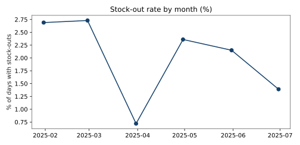
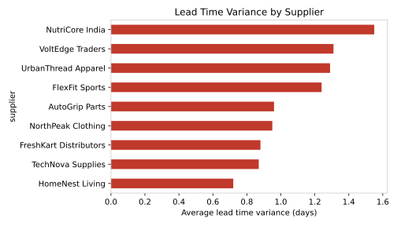
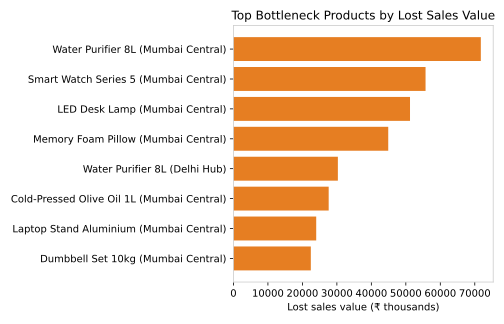
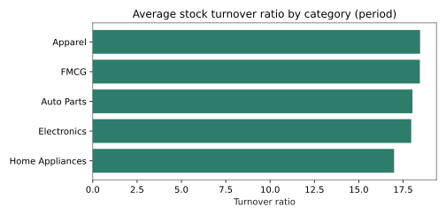

# Supply Chain & Inventory Performance Dashboard

**End-to-end inventory analytics project — SQL · Python (Pandas, SQLAlchemy) · Power BI**

An executive KPI dashboard and analysis pipeline for inventory, warehouse and
fulfilment performance across three regional hubs, built around the four KPIs
operations managers actually ask for: **Stock Turnover Ratio, Carrying Costs,
Lead Time Variance and Stock-out Rates** — plus the bottleneck and overstock
analysis needed to act on them.

> **Portfolio note:** this project recreates, on a synthetic sample dataset,
> the supply chain analytics work I delivered at **Cyepro Solutions**
> (Data Analyst, Jul 2023 – Jan 2026): a PostgreSQL pipeline for
> inventory/warehouse/fulfilment metrics, automated Python ETL for daily stock
> records, and an executive Power BI dashboard. The sample data is generated
> (`python/generate_sample_data.py`, seed 42) — no real company data is used.

## Business problem
Stock-outs lose sales silently, while overstocking ties up cash in carrying
costs. Without a single KPI view, neither problem is visible until month-end.
This project builds the daily pipeline and KPI layer that makes both visible
early — by SKU, by warehouse and by supplier.

## Dataset (sample)
- **24 SKUs** in 5 categories (Electronics, FMCG, Apparel, Home Appliances, Auto Parts)
- **3 warehouses:** Riyadh Central, Jeddah Hub, Dammam Hub
- **13,032 daily stock records**, 1 Jan – 30 Jun 2025 (181 days)
- **1,079 purchase orders** with standard vs actual lead times
- Schema and column definitions: [`data/data_dictionary.md`](data/data_dictionary.md)

## Key results (Jan – Jun 2025)
Money values are shown in Saudi Riyal (SAR) with Indian Rupee (INR)
equivalents at **1 SAR = ₹22.30** (approximate rate, for reporting only).

| KPI | SAR | INR |
|---|---|---|
| Units sold | 243,335 units | — |
| Units lost to stock-outs | 2,712 units | — |
| Overall stock-out rate | 2.0% of SKU-days | — |
| Stock turnover ratio (period) | 18.1 | — |
| Average inventory value | SAR 1,689,742 | ₹37,681,254 |
| Carrying cost (period, 20% p.a. assumption) | SAR 167,585 | ₹3,737,154 |
| Orders arriving after standard lead time | 38.4% (average variance ≈ 0 days) | — |

## Insights
1. **Riyadh Central is stocked too lean.** It sells the most (94,118 units) but
   holds the least average inventory value (SAR 502,619) and has a **3.94%
   stock-out rate — 1,648 lost units, 61% of all lost sales.** Reorder points
   for Riyadh need raising.
2. **Dammam Hub is overstocked.** It holds the most inventory value
   (SAR 621,396) with the fewest sales and a 0.28% stock-out rate — capital is
   sitting there that Riyadh needs. Inter-warehouse transfers beat new orders.
3. **Long-lead-time slow movers stock out most.** Winter Jacket NorthPeak
   (14-day lead time) has the worst stock-out rate at **5.16%** of days,
   followed by Ceramic Dinner Set (4.24%) and Vacuum Cleaner Cyclone (4.05%) —
   these SKUs need higher safety stock, not bigger orders.
4. **Suppliers are "on time on average" but unreliable.** Mean lead time
   variance is ≈ 0 days for every supplier, yet **38.4% of orders arrive
   late** — averages hide the problem; the % late metric exposes it.
5. **Biggest lost-sales value:** Air Fryer 5L (SAR 63,960 ≈ ₹1,426,308),
   Winter Jacket NorthPeak (SAR 56,160 ≈ ₹1,252,368) and Car Battery 70Ah
   (SAR 49,140 ≈ ₹1,095,822).






## Repository structure
```
supply-chain-inventory-performance/
├── README.md
├── data/            sample dataset (CSV) + data dictionary
├── sql/             PostgreSQL schema + 8 KPI queries (incl. LAG() trend)
├── python/          data generator, ETL pipeline, KPI analysis
├── dashboard/       Power BI dashboard build guide + DAX measures
├── images/          KPI charts produced by the analysis
└── outputs/         KPI result tables (CSV) produced by the analysis
```

## How to run
```bash
pip install -r requirements.txt

python python/generate_sample_data.py   # (re)create the sample dataset
python python/etl_pipeline.py           # clean, validate, load to database
python python/kpi_analysis.py           # KPI tables in outputs/, charts in images/
```
The ETL loads into PostgreSQL when `DATABASE_URL` is set, and falls back to a
local SQLite file (`database/supply_chain.db`) so the project runs anywhere.
For Power BI, follow [`dashboard/dashboard_guide.md`](dashboard/dashboard_guide.md)
and paste the measures from [`dashboard/dax_measures.dax`](dashboard/dax_measures.dax).

## SQL highlights
`sql/02_kpi_queries.sql` contains the dashboard's KPI definitions in pure SQL:
stock turnover by SKU, carrying cost by warehouse, stock-out rate, lead time
variance by supplier, bottleneck SKUs, overstocked SKUs, and a monthly
stock-out trend using the `LAG()` window function for month-over-month change.

## Tools
PostgreSQL · SQL (window functions) · Python · Pandas · SQLAlchemy ·
Power BI · DAX · Excel

---
**Syed Musharaf** — Data Analyst, Riyadh, Saudi Arabia
LinkedIn: https://www.linkedin.com/in/syed-musharaf-5250372a6 ·
Portfolio: https://syedmusharaf.github.io
