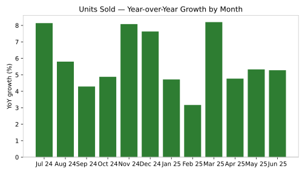

# Supply Chain & Inventory Performance

**SQL · Python (Pandas) · Power BI** — an end-to-end inventory analytics project for a
multi-warehouse Indian distribution network (Mumbai, Delhi, Bengaluru), analysing
65,664 daily stock records and 878 purchase orders across 24 products,
from **Jan 2023 to Jun 2025**. All monetary values are in **Indian Rupees (₹)**, and
every column name is written in clear, full words (see the
[data dictionary](data/data_dictionary.md)).

> 📊 **Dashboards:** open [`dashboard/dashboard.html`](dashboard/dashboard.html) in any
> browser for the full executive dashboard (KPI cards, insights, growth tables, charts).
> The **Power BI** version is fully specced in
> [`dashboard/powerbi_build_guide.md`](dashboard/powerbi_build_guide.md) — measures in
> [`dashboard/dax_measures.dax`](dashboard/dax_measures.dax), data load in
> [`dashboard/power_query_m.txt`](dashboard/power_query_m.txt).

## Business questions
- Which warehouses and products lose the most sales to stock-outs?
- Where is capital locked up in slow-moving, overstocked inventory?
- Which suppliers miss their promised lead times, and by how much?
- What is the real cost of holding inventory (carrying cost)?
- How are sales growing — week over week, month over month, year over year?

## Key results (Jan 2023 – Jun 2025, sample data)

| KPI | Value |
|---|---|
| Total units sold | 967,953 |
| Units lost to stock-outs | 75,082 |
| Overall stock-out rate | 7.20% |
| Stock turnover (annualised) | 50.52× |
| Average inventory value | ₹7,70,85,270 |
| Carrying cost (20% per year) | ₹3,85,21,516 |
| Purchase orders late | 41.1% |
| Average lead-time variance | +1.24 days |

## Growth — LAG comparisons (weekly · monthly · yearly)
Time comparisons are computed with the SQL **`LAG()` window function**
(`sql/02_kpi_queries.sql`, queries 9–11), mirrored in Python with `shift()`
and in Power BI with DAX time-intelligence measures:

- **Weekly:** week-over-week (WoW) growth % for units sold and sales value
  → `outputs/weekly_trend.csv`
- **Monthly:** month-over-month (MoM) and year-over-year (YoY, vs the same
  month last year) growth % → `outputs/monthly_trend.csv`
- **Yearly:** year-over-year growth % → `outputs/yearly_summary.csv`
  (2025 is Jan–Jun only and is flagged as a partial year)

Headline: 2024 units sold grew **+6.1% YoY** over 2023
(sales value +6.0%), and the latest month
(Jun 2025) is **+5.3% vs Jun 2024**.

## Insights
- **Mumbai Central is the bottleneck:** leanest stock, highest demand — a
  11.97% stock-out rate and
  51,245 lost units
  (68% of all lost units network-wide).
- **Bengaluru Hub is overstocked:** the highest average inventory
  (₹2,94,95,779) with the lowest turnover
  (36.38×) — capital sitting in slow stock.

## Top bottleneck products (lost sales value)

| Product | Warehouse | Stock-out rate | Lost units | Lost value |
|---|---|---|---|---|
| Water Purifier 8L | Mumbai Central | 15.00% | 4,468 | ₹7,17,56,080 |
| Smart Watch Series 5 | Mumbai Central | 6.87% | 1,723 | ₹5,57,21,820 |
| LED Desk Lamp | Mumbai Central | 12.40% | 2,945 | ₹5,12,13,550 |
| Memory Foam Pillow | Mumbai Central | 20.69% | 5,161 | ₹4,49,00,700 |
| Water Purifier 8L | Delhi Hub | 7.97% | 1,886 | ₹3,02,89,160 |

## Charts





## Repository structure
```
data/        dim_products, fact_daily_stock, fact_purchase_orders (CSV) + data dictionary
sql/         01_schema_postgresql.sql, 02_kpi_queries.sql (11 KPI queries incl. LAG growth)
python/      generate_sample_data.py, etl_pipeline.py, kpi_analysis.py
dashboard/   dashboard.html + build_dashboard.py (HTML dashboard),
             powerbi_build_guide.md, power_query_m.txt, dax_measures.dax (Power BI pack)
outputs/     KPI tables: summary, by warehouse, by product, supplier lead time,
             weekly / monthly / yearly trends with growth %
images/      Charts (SVG)
```

## How to run
```bash
pip install -r requirements.txt
python python/generate_sample_data.py   # creates the sample dataset (seed 42)
python python/etl_pipeline.py           # validate -> transform -> load (SQLite demo DB)
python python/kpi_analysis.py           # KPI tables + charts + growth comparisons
python dashboard/build_dashboard.py     # builds dashboard/dashboard.html
```
For production, the same schema and queries run on PostgreSQL
(`sql/01_schema_postgresql.sql`); the ETL loads to SQLite locally so the full
pipeline runs anywhere with zero setup.

## Tools & skills demonstrated
PostgreSQL (joins, aggregation, `LAG()` window function for WoW/MoM/YoY growth) ·
Python (Pandas, SQLAlchemy, Matplotlib) · Power BI & DAX (incl. time-intelligence
measures) · KPI design (Stock Turnover, Stock-Out Rate, Carrying Cost, Lead Time
Variance) · Data validation & ETL design

## Note on data
The dataset is **synthetic sample data** generated by
`python/generate_sample_data.py`, modelled on the structure of a real supply
chain & inventory dashboard project (daily stock movements, purchase orders,
reorder levels, supplier lead times). It contains no real company data.

---
**Author:** Syed Musharaf — Data Analyst · [GitHub](https://github.com/syedmusharaf0)
